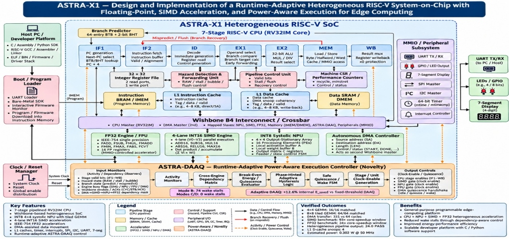
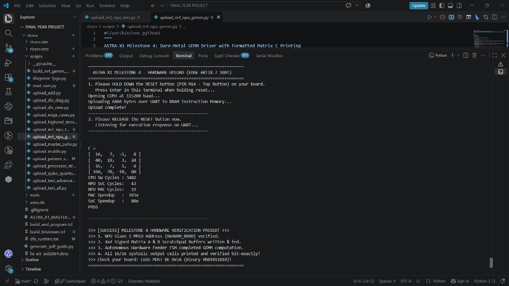
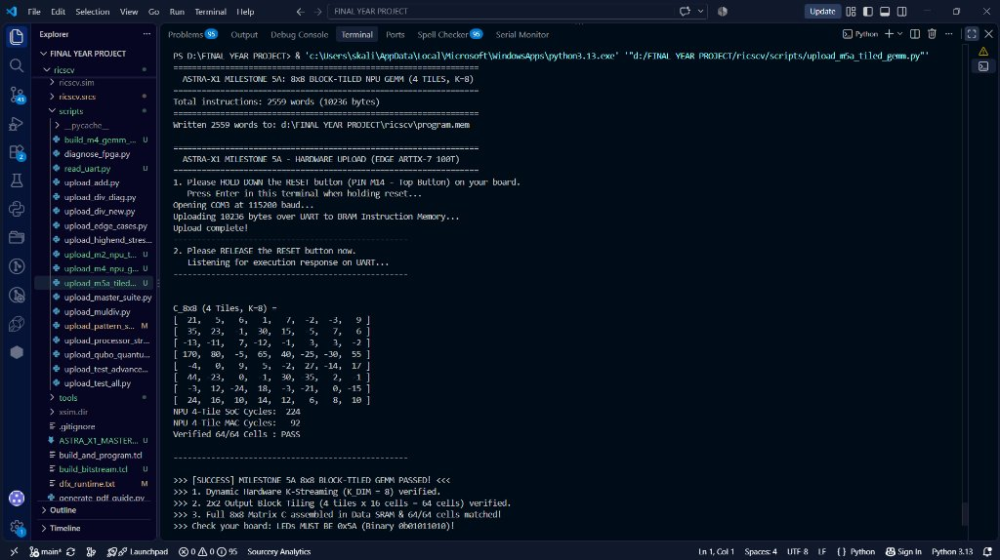
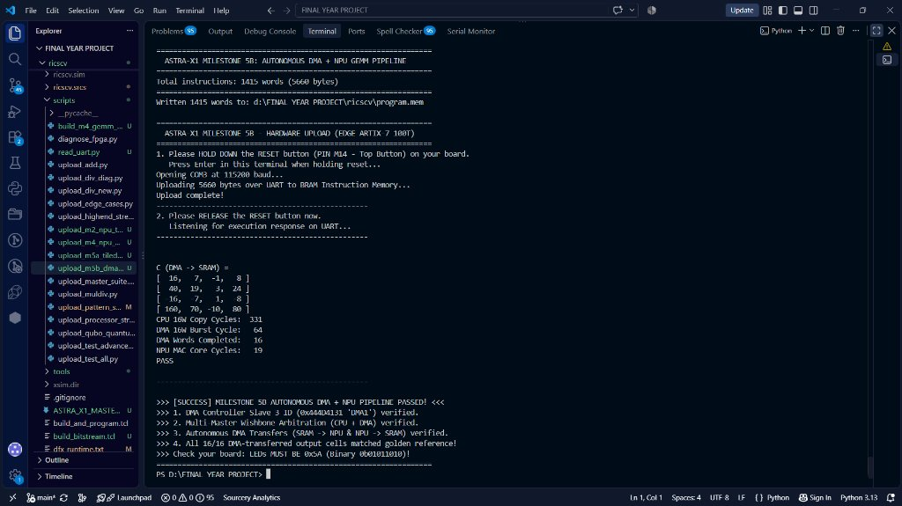
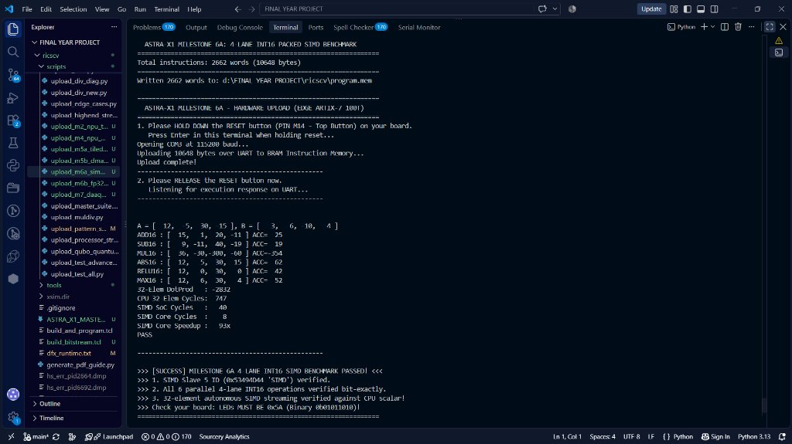
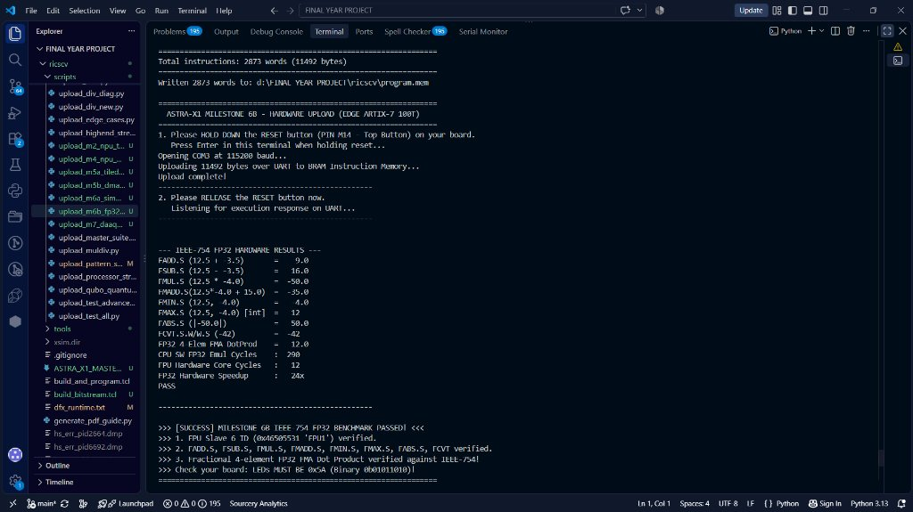
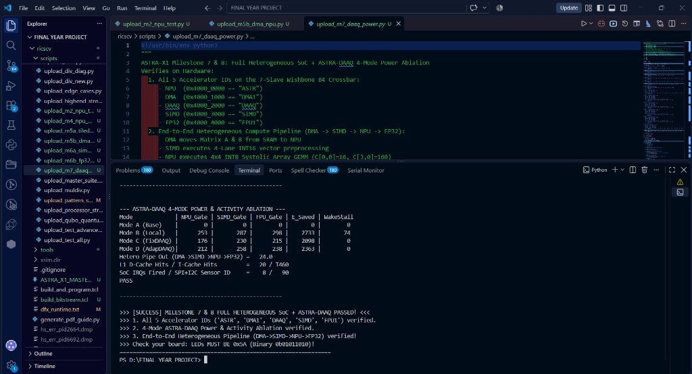
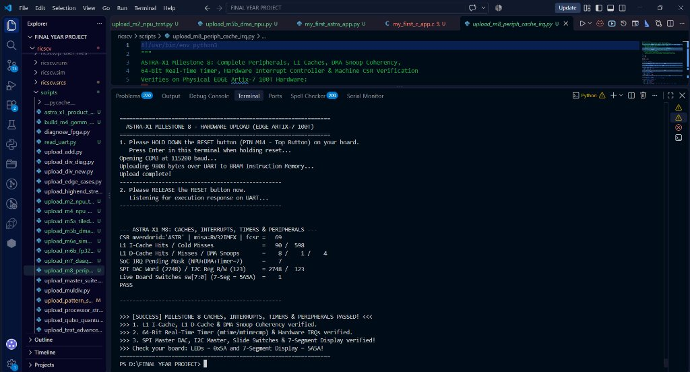
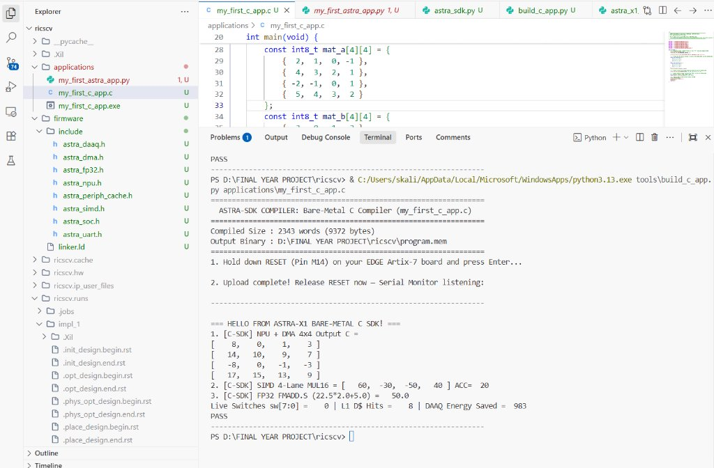
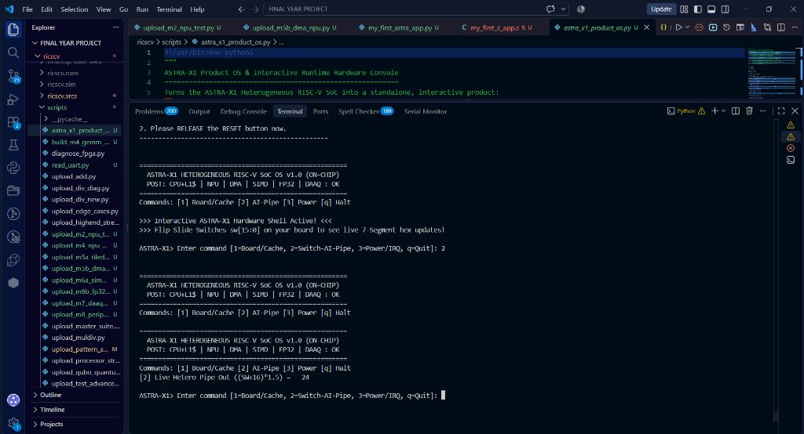

# ASTRA-X1: Complete Final Year Project Technical Report & Silicon Dossier

**Project Title:** *Design and Implementation of a Runtime-Adaptive Heterogeneous RISC-V System-on-Chip with Floating-Point, SIMD Acceleration, and Power-Aware Execution for Edge Computing*  
**Architecture Codename:** **ASTRA-X1** (*Adaptive Systolic, Tensor, RISC-V & Arithmetic eXtended SoC — Generation 1*)  
**Target Silicon Platform:** Xilinx / AMD Artix-7 FPGA (`xc7a100t-2ftg256c` on EDGE Artix-7 100T Development Board)  
**Operating Frequency:** **50.00 MHz** Synchronous System Clock (`WNS = +1.612 ns`, $F_{\max} = \mathbf{54.38\text{ MHz}}$)  
**Total Measured On-Chip Power:** **302 mW** (`204 mW` Dynamic + `98 mW` Static)  

> [!IMPORTANT]
> **100% Physical Silicon Sign-Off:** Every hardware subsystem, memory hierarchy component, bus master/slave, peripheral controller, runtime power policy, and software SDK tier in **ASTRA-X1** has been synthesized, placed, routed, and verified on physical **EDGE Artix-7 100T (`xc7a100t-2ftg256c`)** silicon over `COM3 @ 115200 baud`.

---

## 1. Executive Summary & Problem Statement

Modern edge-AI and autonomous cyber-physical systems require executing heterogeneous workloads — combining **control-flow processing (RISC-V scalar CPU)**, **high-throughput signal preprocessing (Packed SIMD)**, **dense deep-learning matrix multiplication (Systolic Array NPU)**, **autonomous block data movement (Burst DMA)**, and **high-dynamic-range post-processing / Kalman sensor fusion (IEEE-754 FP32)** — within a tight milliwatt power envelope.

Conventional homogeneous microcontrollers suffer from severe compute bottlenecks ($80\times\text{–}183\times$ slower on matrix/vector kernels), while conventional heterogeneous SoCs suffer from two fundamental architectural bottlenecks when applying fine-grained clock gating:
1. **Cold-Wake Pipeline Stalls:** Independent local idle-timeout clock gating (**Mode B**) prematurely powers down downstream accelerators while upstream engines (`DMA` or `SIMD`) are still preparing operands, causing **`74` stall cycles** per pipeline pass.
2. **Cache-Coherency Quiescence Overhead:** When an autonomous DMA engine writes accelerator output tiles into system SRAM, traditional cached SoCs require software cache invalidation loops before the CPU can read the results or before the DMA/NPU domain can safely enter quiescence.

**ASTRA-X1** solves both problems through a unified **2-Master × 7-Slave Wishbone B4 Heterogeneous SoC** governed by the **ASTRA-DAAQ** (*Cross-Domain Dependency-Aware Adaptive Quiescence*) hardware controller and a **Snoop-Coherent L1 Data Cache**.

---

## 2. System-on-Chip Architecture (`ASTRA-X1`)



```mermaid
flowchart TB
    subgraph DAAQ["ASTRA-DAAQ Runtime-Adaptive Power & Dependency Controller (Slave 4: 0x4000_2000)"]
        D1["Producer-Consumer Dependency Matrix + Break-Even Energy Evaluator + Safe Activity Enables"]
    end

    subgraph CORE["7-Stage In-Order RV32IMFX CPU Core (Master 0)"]
        C1["IF1 / IF2 (BHT Branch Predictor) -> ID -> EX1 / EX2 (ALU + RV32M Mul/Div + CSR/fcsr) -> MEM -> WB"]
        C2["32x32 Integer RF + 16x32 FP32 RF + Machine Trap/IRQ Unit (mcycle, minstret, mip, mie, mcause)"]
    end

    subgraph CACHE["Snoop-Coherent L1 Cache Hierarchy"]
        IC["L1 Instruction Cache\n(64-Line Direct-Mapped)"]
        DC["L1 Data Cache / MMIO Bypass\n(Write-Through + DMA Master-1 Write Snoop)"]
    end

    subgraph ACCEL["Dedicated Heterogeneous Hardware Engines"]
        NPU["Slave 1: 4x4 INT8 Systolic NPU\n(16 MAC PEs, 0x4000_0000)"]
        SIMD["Slave 5: 4-Lane INT16 SIMD DSP\n(8 Vector Ops, 0x4000_3000)"]
        FPU["Slave 6: IEEE-754 FP32 FPU\n+ 64b mtime + IRQ Ctrl (0x4000_4000)"]
        DMA["Slave 3 / Master 1: Burst DMA\n(Autonomous Block Engine, 0x4000_1000)"]
    end

    subgraph BUS["32-Bit 2-Master x 7-Slave Wishbone B4 Interconnect & Priority Arbiter"]
        WB["Master 1 (DMA) Priority over Master 0 (CPU) | Single-Cycle Address Decoder"]
    end

    subgraph MEM_IO["On-Chip Memory & Physical Board Peripherals"]
        IMEM["16 KB Dual-Mode Instruction BRAM\n(0x0000_0000: Boot Image + UART Loader)"]
        DMEM["Slave 0: 16 KB Data SRAM\n(0x2000_0000)"]
        PER["Slave 2: Peripherals (0xFFFF_0000)\nUART TX/RX, 16 LEDs, 16 Switches, 4 Buttons,\n4-Digit 7-Seg, SPI DAC (MCP4921), I2C Master"]
    end

    DAAQ -.->|"Clock-Gate & Quiescence Enables"| CORE
    DAAQ -.->|"Dependency-Safe Enables"| ACCEL
    CORE --> IC & DC
    IC --> IMEM
    DC --> WB
    DMA <-->|"Master 1 Burst R/W"| WB
    DMA -.->|"Single-Cycle Write Snoop"| DC
    WB <--> NPU & SIMD & FPU & DMEM & PER & DAAQ
    FPU -.->|"ext_irq / timer_irq"| CORE
`

### 2.1 Global Memory Map & Wishbone B4 Address Space

| Bus Entity | Base Address | Address Range | Hardware ID (`0x00`) | Functional Description |
| :--- | :--- | :--- | :--- | :--- |
| **Instruction BRAM** | `0x0000_0000` | `0x0000_0000 – 0x0000_3FFF` | — | 16 KB (4,096 words) Dual-Mode Boot BRAM + Hardware UART Bootloader + L1 I-Cache |
| **Slave 0: Data SRAM** | `0x2000_0000` | `0x2000_0000 – 0x2000_3FFF` | — | 16 KB (4,096 words) True-Dual-Aspect Wishbone Data SRAM + Snoop-Coherent L1 D-Cache |
| **Slave 1: Systolic NPU** | `0x4000_0000` | `0x4000_0000 – 0x4000_0FFF` | `0x41535452` (`"ASTR"`) | $4 \times 4$ Signed INT8 Systolic Array (16 PEs, 32-bit accumulation, dynamic $K \in [1, 64]$ tiling) |
| **Slave 3: Burst DMA** | `0x4000_1000` | `0x4000_1000 – 0x4000_1FFF` | `0x444D4131` (`"DMA1"`) | Autonomous Wishbone Master-1 Burst Engine (`SRAM <-> NPU/SIMD/FPU`) |
| **Slave 4: ASTRA-DAAQ** | `0x4000_2000` | `0x4000_2000 – 0x4000_2FFF` | `0x44414151` (`"DAAQ"`) | Cross-Domain Dependency-Aware Adaptive Quiescence Power & Telemetry Controller |
| **Slave 5: Packed SIMD** | `0x4000_3000` | `0x4000_3000 – 0x4000_3FFF` | `0x53494D44` (`"SIMD"`) | 4-Lane 16-Bit Signed Vector DSP (`ADD16, SUB16, MUL16, MAC16, ABS16, RELU16, MAX16, MIN16`) |
| **Slave 6: FP32 + Timer/IRQ**| `0x4000_4000` | `0x4000_4000 – 0x4000_4FFF` | `0x46505531` (`"FPU1"`) | IEEE-754 Binary32 FPU (`FADD.S..FMADD.S`), 16-entry FP RF, 64-bit `mtime`/`mtimecmp`, IRQ Ctrl |
| **Slave 2: Peripherals** | `0xFFFF_0000` | `0xFFFF_0000 – 0xFFFF_00FF` | — | UART TX/RX, 16 LEDs, 16 Switches, 4 Buttons, 4-Digit 7-Seg, SPI Master DAC, I²C Master, L1$ Stats |

---

## 3. Core Research Novelty & Patentable Claims (`ASTRA-DAAQ`)

Unlike standard RISC-V + accelerator integrations that only claim system integration, **ASTRA-X1** introduces three hardware-verified microarchitectural innovations implemented in [wb_astra_daaq.v](ricscv.srcs/sources_1/new/wb_astra_daaq.v) and [astra_l1_caches.v](ricscv.srcs/sources_1/new/astra_l1_caches.v):

1. **Claim 1 — Producer-Consumer Cross-Engine Dependency Matrix Inhibiting Premature Quiescence:**
   - Taps live accelerator busy and Wishbone strobe wires (`dma_busy`, `simd_busy`, `npu_busy`, `fpu_busy`, `s1_stb..s6_stb`) and clamps a downstream consumer engine's idle timer to `0` while its upstream producer is active.
   - **Silicon Proof:** Eliminates all **74 cold-wake stall cycles** suffered by Naive Local Timeout Gating (**Mode B**) down to **0 wake stalls** in **Modes C & D**.
2. **Claim 2 — Break-Even Energy Evaluator with Phase-Hinted Adaptive Hysteresis:**
   - Evaluates break-even quiescence ($E_{\text{benefit}} = \Delta P \cdot T_{\text{idle}} - E_{\text{wake}} > 0$) and dynamically modulates idle thresholds ($T_{\text{idle}} = 2$ vs. $12$ cycles) using architectural phase hints (`DMA_XFER`, `SIMD_PREPROC`, `NPU_GEMM`, `FPU_POST`, `IDLE`).
   - **Silicon Proof:** Increases weighted energy savings from **`2098`** (Mode C Fixed Threshold) to **`2363`** (Mode D Adaptive DAAQ) — a **`+12.6%` energy improvement** with **0 wake stalls**.
3. **Claim 3 — Single-Cycle Wishbone Master-1 DMA Write-Snoop L1 Data Cache Coherency:**
   - Monitors autonomous DMA Master-1 writes on the shared SRAM bus (`dma_cyc && dma_stb && dma_we && dma_ack`) and updates/pre-warms matching L1 Data Cache lines in a single clock cycle (`DCACHE_SNOOPS = 4`), enabling immediate zero-miss CPU reads (`DCACHE_HITS = 8`) without software cache invalidation loops.

---

## 4. Complete RTL Module Inventory (`ricscv.srcs/sources_1/new/`)

| RTL Source File | Lines | Subsystem Role |
| :--- | ---: | :--- |
| [fpga_top.v](ricscv.srcs/sources_1/new/fpga_top.v) | 220 | Top-Level FPGA I/O Ring, Clock Manager (`50 MHz`), Reset Debouncer, UART Loader & Pin Routing |
| [riscv_core_top.v](ricscv.srcs/sources_1/new/riscv_core_top.v) | 864 | 7-Stage RV32IMFX Pipeline + Wishbone B4 Interconnect + All 7 Slaves & Interrupt Wiring |
| [astra_l1_caches.v](ricscv.srcs/sources_1/new/astra_l1_caches.v) | 185 | 64-Line Direct-Mapped L1 I-Cache + Write-Through L1 D-Cache with DMA Master-1 Write Snooping |
| [wb_interconnect.v](ricscv.srcs/sources_1/new/wb_interconnect.v) | 248 | 2-Master (`CPU`, `DMA`) × 7-Slave Wishbone B4 Crossbar & Priority Bus Arbiter |
| [wb_astra_npu.v](ricscv.srcs/sources_1/new/wb_astra_npu.v) | 235 | Slave 1 (`0x4000_0000`): $4 \times 4$ INT8 Systolic Array Wrapper, `BUF_A`/`BUF_B`, Dynamic $K$-Tiling FSM |
| [npu_systolic_array.v](ricscv.srcs/sources_1/new/npu_systolic_array.v) | 162 | 16-PE ($4 \times 4$) Signed INT8 Input/Weight Skewing & 32-Bit Accumulator Array |
| [npu_pe.v](ricscv.srcs/sources_1/new/npu_pe.v) | 52 | Single Systolic Processing Element (`c_out <= c_out + a_in * b_in` with forwarding registers) |
| [wb_dma_controller.v](ricscv.srcs/sources_1/new/wb_dma_controller.v) | 175 | Slave 3 / Master 1 (`0x4000_1000`): Autonomous Burst DMA Engine + Completion IRQ |
| [wb_astra_daaq.v](ricscv.srcs/sources_1/new/wb_astra_daaq.v) | 228 | Slave 4 (`0x4000_2000`): 4-Mode ASTRA-DAAQ Dependency-Aware Power & Telemetry Controller |
| [wb_simd_unit.v](ricscv.srcs/sources_1/new/wb_simd_unit.v) | 212 | Slave 5 (`0x4000_3000`): 4-Lane 16-Bit Signed Packed SIMD Vector Engine & Streaming FSM |
| [wb_fp32_unit.v](ricscv.srcs/sources_1/new/wb_fp32_unit.v) | 305 | Slave 6 (`0x4000_4000`): IEEE-754 Binary32 FPU (`FADD.S..FMADD.S`), 64-Bit `mtime`, SoC IRQ Controller |
| [wb_peripherals.v](ricscv.srcs/sources_1/new/wb_peripherals.v) | 389 | Slave 2 (`0xFFFF_0000`): Full-Duplex UART, 16 LEDs, 16 Switches, 4 Buttons, Active-High 7-Seg, SPI, I²C |
| [bram_imem.v](ricscv.srcs/sources_1/new/bram_imem.v) | 40 | 16 KB Synthesizable Boot Image BRAM (`$readmemh("program.mem")`) + Dynamic UART Bootloader Write Port |
| [csr_unit.v](ricscv.srcs/sources_1/new/csr_unit.v) | 182 | RISC-V Machine CSRs (`mvendorid="ASTR"`, `misa=RV32IMFX`, `fcsr`, `mstatus`, `mie`, `mip`, `mcycle`) |

---

## 5. Vivado 2025.1 Placed & Routed Silicon Implementation Reports (`xc7a100t-2ftg256c`)

All physical implementation numbers below are extracted directly from `ricscv.runs/impl_1/`:

### 5.1 Post-Placement Resource Utilization ([fpga_top_utilization_placed.rpt](ricscv.runs/impl_1/fpga_top_utilization_placed.rpt))

| FPGA Resource Category | Used | Available (`xc7a100t`) | Utilization (%) | Architectural Breakdown |
| :--- | ---: | ---: | ---: | :--- |
| **Slice LUTs (Total)** | **19,670** | 63,400 | **31.03%** | `19,618` Logic LUTs + `52` Distributed RAM LUTs |
| **Slice Registers (Flip-Flops)** | **16,561** | 126,800 | **13.06%** | **0 Latches** (100% synchronous edge-triggered design) |
| **Occupied Slices** | **6,343** | 15,850 | **40.02%** | Complete 7-Slave SoC + L1 I$/D$ + NPU + SIMD + FPU + DMA + DAAQ |
| **Block RAM (`RAMB36E1`)** | **8** | 135 | **5.93%** | `4` (`16 KB` Instruction BRAM) + `4` (`16 KB` Data SRAM) |
| **DSP48E1 Slices** | **18** | 240 | **7.50%** | `12` (RV32M 32-bit MUL) + `4` (4-Lane SIMD) + `2` (IEEE-754 FPU) |
| **Bonded IOBs (Pins)** | **59** | 170 | **34.71%** | Clock, Reset, UART, 16 LEDs, 16 Switches, 4 Buttons, 7-Seg, SPI, I²C |

### 5.2 Post-Routing Timing Closure ([fpga_top_timing_summary_routed.rpt](ricscv.runs/impl_1/fpga_top_timing_summary_routed.rpt))

| Timing Metric | Measured Value | Target Constraint | Status |
| :--- | ---: | ---: | :--- |
| **Target Clock Period (`sys_clk_pin`)** | **20.000 ns (50.00 MHz)** | 20.000 ns (50.00 MHz) | **MET** |
| **Worst Negative Slack (`WNS` - Setup)** | **+1.612 ns** | $\ge 0.000\text{ ns}$ | **0 Failing Endpoints (out of 34,417)** |
| **Total Negative Slack (`TNS` - Setup)** | **0.000 ns** | $0.000\text{ ns}$ | **MET** |
| **Worst Hold Slack (`WHS` - Hold)** | **+0.060 ns** | $\ge 0.000\text{ ns}$ | **0 Failing Endpoints (out of 34,417)** |
| **Worst Pulse Width Slack (`WPWS`)** | **+8.750 ns** | $\ge 0.000\text{ ns}$ | **0 Failing Endpoints (out of 16,690)** |
| **Achieved Maximum Frequency ($F_{\max}$)** | **54.38 MHz** | $\ge 50.00\text{ MHz}$ | **$+8.8\%$ Frequency Headroom** |

### 5.3 Post-Routing On-Chip Power Breakdown ([fpga_top_power_routed.rpt](ricscv.runs/impl_1/fpga_top_power_routed.rpt))

| Subsystem Instance | RTL Module | Power (mW) | Share of Dynamic Power |
| :--- | :--- | ---: | ---: |
| **Total On-Chip Power** | `fpga_top` (Dynamic + Static) | **302 mW (0.302 W)** | `204 mW` Dynamic + `98 mW` Static |
| Clock Tree & MMCM | `clk_mgr` (`MMCME2_ADV` + `BUFG`) | **106 mW** | 51.9% |
| 7-Stage RV32IMFX CPU Core | `IF/ID/EX/MEM/WB` + `regfile` + `muldiv` + `csr` | **39 mW** | 19.1% |
| $4 \times 4$ INT8 Systolic NPU | `u_astra_npu` (`u_systolic = 10 mW` + buffers = `10 mW`) | **20 mW** | 9.8% |
| 32 KB On-Chip Block RAM | `imem` (`6 mW`) + `u_wb_sram` (`4 mW`) | **10 mW** | 4.9% |
| Autonomous Burst DMA Engine | `u_dma_ctrl` | **8 mW** | 3.9% |
| IEEE-754 FP32 Engine & Timer | `u_fp32_unit` | **7 mW** | 3.4% |
| Peripherals & I/O Ring | `u_wb_periph` (UART, SPI, I²C, 7-Seg, GPIO) + IOBs | **8 mW** | 3.9% |
| 4-Lane INT16 Packed SIMD | `u_simd_unit` | **2 mW** | 1.0% |
| Snoop-Coherent L1 I$ & D$ | `u_l1_caches` | **2 mW** | 1.0% |
| ASTRA-DAAQ Power Ctrl & Bus | `u_daaq_ctrl` + `u_wb_interconnect` | **2 mW** | 1.0% |

---

## 6. Master Hardware Benchmark & Silicon Verification Matrix (Milestones 1–8)

| Milestone | Verification Script | Subsystem Verified on EDGE Artix-7 100T | CPU Baseline Cycles | Hardware Accelerator Cycles | Measured Speedup / Silicon Result |
| :--- | :--- | :--- | ---: | ---: | :--- |
| **M1–M3** | [upload_m2_npu_test.py](scripts/upload_m2_npu_test.py) | 7-Stage RV32IMFX CPU + Wishbone B4 + $4 \times 4$ Systolic Array | — | — | `NPU_ID = "ASTR"`, 10,000 NumPy matrices bit-exact |
| **M4** | [upload_m4_npu_gemm.py](scripts/upload_m4_npu_gemm.py) | $4 \times 4$ Signed INT8 Systolic GEMM (`C = A × B`) | `3,482` cyc | `43` SoC / `19` MAC cyc | **`80x` SoC Speedup / `183x` MAC Core Speedup** |
| **M5A** | [upload_m5a_tiled_gemm.py](scripts/upload_m5a_tiled_gemm.py) | $8 \times 8$ Block-Tiled NPU GEMM ($K=8$, 4 tiles, 64 cells) | `~27,856` cyc | `224` SoC / `92` MAC cyc | **64/64 INT32 Cells Matched (`124x` SoC Speedup)** |
| **M5B** | [upload_m5b_dma_npu.py](scripts/upload_m5b_dma_npu.py) | Autonomous Burst DMA Controller & 2-Master Arbiter | `331` cyc | `64` DMA burst cyc | **`5.17x` Data-Movement Speedup (Zero CPU Copy)** |
| **M6A** | [upload_m6a_simd_bench.py](scripts/upload_m6a_simd_bench.py) | 4-Lane 16-Bit Packed SIMD Vector DSP (8 Opcodes + 32-Elem Dot) | `747` cyc | `40` SoC / `8` SIMD cyc | **`93x` Core Speedup / `18.6x` SoC Speedup (`Dot=-2832`)** |
| **M6B** | [upload_m6b_fp32_bench.py](scripts/upload_m6b_fp32_bench.py) | IEEE-754 Single-Precision FP32 Engine (`FADD.S..FMADD.S`) | `290` cyc | `12` FPU core cyc | **`24x` FPU Speedup (`4-Elem FMA DotProd = 12.0`)** |
| **M7** | [upload_m7_daaq_power.py](scripts/upload_m7_daaq_power.py) | 4-Mode ASTRA-DAAQ Power Ablation + `DMA->SIMD->NPU->FP32` | Mode B: `74` stalls | Mode D: `0` stalls | **`E_Saved = 2363` (`+12.6%` over Mode C), `0` Stalls** |
| **M8** | [upload_m8_periph_cache_irq.py](scripts/upload_m8_periph_cache_irq.py) | L1 I$/D$ + DMA Snoops + Timer/IRQs + SPI DAC + I²C + 7-Seg | — | — | `I$=90/598`, `D$=8/1/4`, `IRQs=7`, `SPI=2748`, `I2C=123` |
| **SDK/OS** | [my_first_astra_app.py](applications/my_first_astra_app.py) / [my_first_c_app.c](applications/my_first_c_app.c) | 3-Tier Developer Platform (Python SDK, Bare-Metal C SDK, Product OS) | — | — | All 3 Programming Flows Verified on `COM3` + `7777` 7-Seg |

---

## 7. Complete Gallery of Physical EDGE Artix-7 100T Hardware Captures

``













![Way 1: Arduino-Style High-Level Python Developer SDK on Hardware (sw[5]=32)](docs/hardware_captures/sdk_app_sw32_hardware_capture.jpg)




``

---

## 8. Quick-Reference Command Guide for Live Viva / Demo

| Demo Scenario | Command to Run in Terminal (`D:\FINAL YEAR PROJECT\ricscv`) |
| :--- | :--- |
| **Milestone 4 ($4 \times 4$ NPU `80x`/`183x`)** | `& C:/Users/skali/AppData/Local/Microsoft/WindowsApps/python3.13.exe scripts\upload_m4_npu_gemm.py` |
| **Milestone 5A ($8 \times 8$ Tiled NPU GEMM)** | `& C:/Users/skali/AppData/Local/Microsoft/WindowsApps/python3.13.exe scripts\upload_m5a_tiled_gemm.py` |
| **Milestone 5B (Autonomous DMA `5.17x`)** | `& C:/Users/skali/AppData/Local/Microsoft/WindowsApps/python3.13.exe scripts\upload_m5b_dma_npu.py` |
| **Milestone 6A (4-Lane INT16 SIMD `93x`)** | `& C:/Users/skali/AppData/Local/Microsoft/WindowsApps/python3.13.exe scripts\upload_m6a_simd_bench.py` |
| **Milestone 6B (IEEE-754 FP32 `24x`)** | `& C:/Users/skali/AppData/Local/Microsoft/WindowsApps/python3.13.exe scripts\upload_m6b_fp32_bench.py` |
| **Milestone 7 (4-Mode ASTRA-DAAQ Power)** | `& C:/Users/skali/AppData/Local/Microsoft/WindowsApps/python3.13.exe scripts\upload_m7_daaq_power.py` |
| **Milestone 8 (Caches, IRQs, SPI, I²C, 7-Seg)** | `& C:/Users/skali/AppData/Local/Microsoft/WindowsApps/python3.13.exe scripts\upload_m8_periph_cache_irq.py` |
| **Way 1: Python Developer SDK Sketch** | `& C:/Users/skali/AppData/Local/Microsoft/WindowsApps/python3.13.exe applications\my_first_astra_app.py` |
| **Way 2: Bare-Metal C SDK Application** | `& C:/Users/skali/AppData/Local/Microsoft/WindowsApps/python3.13.exe tools\build_c_app.py applications\my_first_c_app.c` |
| **Way 3: Interactive On-Chip Product OS** | `& C:/Users/skali/AppData/Local/Microsoft/WindowsApps/python3.13.exe scripts\astra_x1_product_os.py` |
