# ASTRA-X1: A Runtime-Adaptive Heterogeneous RISC-V System-on-Chip for Edge Computing

[](https://github.com/KALIFFATHULLAHS/ASTRA-X1-A-Runtime-Adaptive-Heterogeneous-RISC-V-System-on-Chip-Edge-Computing)
[](docs/vivado_reports/fpga_top_utilization_placed.rpt)
[-059669?style=for-the-badge)](docs/vivado_reports/fpga_top_timing_summary_routed.rpt)
[](docs/vivado_reports/fpga_top_power_routed.rpt)
[](ASTRA_X1_FINAL_PROJECT_REPORT.pdf)

> **Full Project Title:** *Design and Implementation of a Runtime-Adaptive Heterogeneous RISC-V System-on-Chip with Floating-Point, SIMD Acceleration, and Power-Aware Execution for Edge Computing*  
> **Target Hardware:** EDGE Artix-7 100T Development Board (`xc7a100t-2ftg256c` @ **50.00 MHz**, $F_{\max} = \mathbf{54.38\text{ MHz}}$)  
> **Deliverables Included:** Synthesizable Verilog RTL (`ricscv.srcs/`), Multi-Language Developer SDK (`tools/`, `firmware/`, `applications/`), Interactive On-Chip OS (`scripts/astra_x1_product_os.py`), Milestone 1–8 Hardware Verification Suites (`scripts/`), Full Technical Report PDF ([ASTRA_X1_FINAL_PROJECT_REPORT.pdf](ASTRA_X1_FINAL_PROJECT_REPORT.pdf)), and IEEE LaTeX Paper ([ASTRA_X1_IEEE_PAPER.tex](ASTRA_X1_IEEE_PAPER.tex)).

---

## 1. System-on-Chip Architecture Overview

**ASTRA-X1** is a complete, silicon-verified 32-bit heterogeneous RISC-V System-on-Chip designed for power-constrained edge-AI, signal processing, and autonomous control workloads.

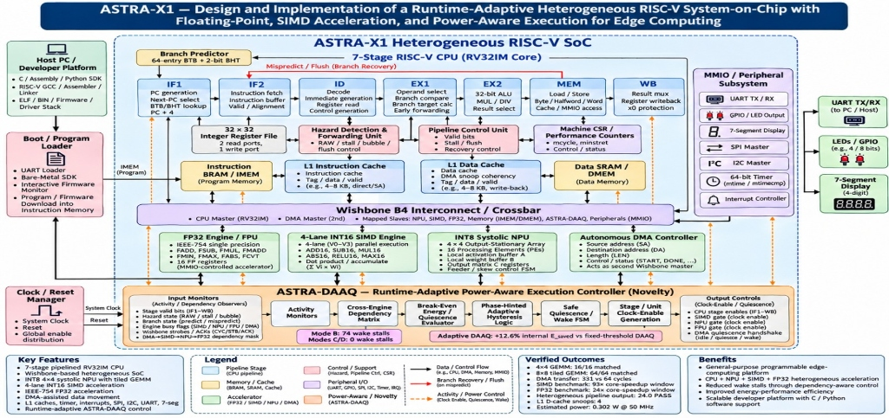

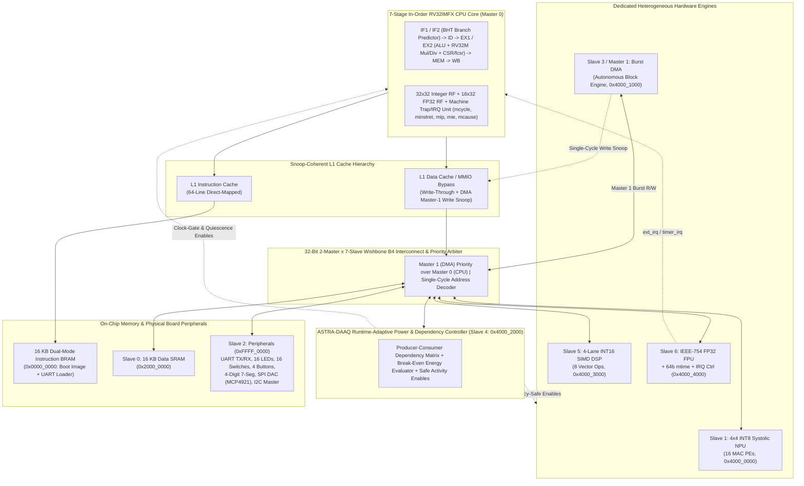

### Global Memory Map (`32-Bit Wishbone B4 Interconnect`)

| Bus Entity | Base Address | Address Range | Hardware ID (`0x00`) | Architectural Description |
| :--- | :--- | :--- | :--- | :--- |
| **Instruction BRAM** | `0x0000_0000` | `0x0000_0000 – 0x0000_3FFF` | — | 16 KB Dual-Mode Boot BRAM (`$readmemh`) + Hardware UART Bootloader + L1 I-Cache |
| **Slave 0: Data SRAM** | `0x2000_0000` | `0x2000_0000 – 0x2000_3FFF` | — | 16 KB Wishbone Data SRAM + Single-Cycle DMA Write-Snoop Coherent L1 D-Cache |
| **Slave 1: Systolic NPU** | `0x4000_0000` | `0x4000_0000 – 0x4000_0FFF` | `0x41535452` (`"ASTR"`) | $4 \times 4$ Signed INT8 Systolic Array (16 PEs, 32-bit Acc, Dynamic $K \in [1, 64]$ Tiling) |
| **Slave 3: Burst DMA** | `0x4000_1000` | `0x4000_1000 – 0x4000_1FFF` | `0x444D4131` (`"DMA1"`) | Autonomous Wishbone Master-1 Burst Engine (`SRAM <-> NPU/SIMD/FPU`) + IRQ |
| **Slave 4: ASTRA-DAAQ** | `0x4000_2000` | `0x4000_2000 – 0x4000_2FFF` | `0x44414151` (`"DAAQ"`) | Cross-Domain Dependency-Aware Adaptive Quiescence Power & Telemetry Controller |
| **Slave 5: Packed SIMD** | `0x4000_3000` | `0x4000_3000 – 0x4000_3FFF` | `0x53494D44` (`"SIMD"`) | 4-Lane 16-Bit Signed Vector DSP (`ADD16, SUB16, MUL16, MAC16, ABS16, RELU16, MAX16, MIN16`) |
| **Slave 6: FP32 & Timer** | `0x4000_4000` | `0x4000_4000 – 0x4000_4FFF` | `0x46505531` (`"FPU1"`) | IEEE-754 Binary32 FPU (`FADD.S..FMADD.S`), 16-entry FP RF, 64-bit `mtime`/`mtimecmp`, IRQ Ctrl |
| **Slave 2: Peripherals** | `0xFFFF_0000` | `0xFFFF_0000 – 0xFFFF_00FF` | — | UART TX/RX, 16 LEDs, 16 Switches, 4 Buttons, Active-High 7-Seg, SPI DAC, I²C, L1$ Stats |

---

## 2. Multi-Language Developer SDK & Programming Package (`astra-x1-sdk`)

Just like **Arduino IDE / ESP-IDF** for an ESP32 or an interactive **Linux shell on a Raspberry Pi**, **ASTRA-X1** ships with a complete, zero-re-synthesis **Multi-Language Developer Platform** that lets any user program the SoC over USB-UART (`COM3 @ 115200 baud`) in **4 different ways**:

### Installation
```bash
pip install -r requirements.txt
# Or install as an editable Python package:
pip install -e .
```

---

### Mode 1: High-Level Python-to-RISC-V Sketch SDK (`tools/astra_sdk.py`)

Write a 20-line Python sketch using `from tools import AstraApp` and compile + upload directly to the RISC-V SoC over USB-UART in 2 seconds!

#### Example (`applications/my_first_astra_app.py`)
```python
from tools import AstraApp

# 1. Create an ASTRA-X1 Application
app = AstraApp("Developer Custom Edge-AI & DSP Sketch")

# 2. Configure Adaptive DAAQ Power Manager & Display "2026" on 4-Digit 7-Segment Display
app.daaq_set_mode("ADAPTIVE")
app.seven_seg_hex(0x2026)
app.println("\r\n=== HELLO FROM ASTRA-X1 DEVELOPER SDK! ===")

# 3. Offload 4x4 Signed INT8 Matrix Multiplication to Systolic NPU via Autonomous DMA
A = [[ 2,  1,  0, -1], [ 4,  3,  2,  1], [-2, -1,  0,  1], [10,  5,  2,  1]]
B = [[ 3,  0,  1,  2], [ 1,  4,  0, -1], [ 0,  2,  5,  1], [-1,  1,  2,  3]]
app.npu_matmul_4x4(A, B, use_dma=True, print_label="1. NPU + DMA 4x4 Matrix Output C =")

# 4. Execute 4-Lane 16-bit Signed SIMD Vector Operation
app.simd_vector_op("ADD16", vec_a=(100, -50, 250, -120), vec_b=(25, 50, -50, 20),
                   print_label="2. SIMD 4-Lane ADD16 =")

# 5. Execute IEEE-754 Single-Precision FP32 Fused Multiply-Add (15.5 * 2.0 + 9.0 = 40.0)
app.fpu_compute("FMADD.S", a=15.5, b=2.0, c=9.0,
                print_label="3. FP32 FMADD.S (15.5 * 2.0 + 9.0) = ")

# 6. Read Live Physical Slide Switches, L1 D-Cache Hits & DAAQ Energy Saved
app.print_board_telemetry()

# 7. Compile to Native RV32IMFX Machine Code & Upload over USB-UART (COM3)
app.build_and_run()
```

#### Run Command
```powershell
python applications/my_first_astra_app.py
```

#### Python SDK (`AstraApp`) Complete API Reference

| SDK Method | Parameters | Hardware Action on ASTRA-X1 |
| :--- | :--- | :--- |
| `app.npu_matmul_4x4(mat_a, mat_b, use_dma=True, print_label=...)` | `mat_a`, `mat_b`: $4 \times 4$ INT8 lists (`-128..127`) | Packs matrices into SRAM (`0x2000_0100`), triggers Autonomous DMA bursts to NPU (`0x4000_0100`), executes 16-PE Systolic GEMM, and prints $4 \times 4$ INT32 output `C`. |
| `app.simd_vector_op(op, vec_a, vec_b, print_label=...)` | `op`: `"ADD16"`, `"SUB16"`, `"MUL16"`, `"MAC16"`, `"ABS16"`, `"RELU16"`, `"MAX16"`, `"MIN16"` | Packs four 16-bit signed lanes into `SIMD_VEC_A/B` (`0x4000_3000`), executes in 1 cycle, and prints all 4 output lanes + accumulator `ACC`. |
| `app.fpu_compute(op, a, b, c=0.0, print_label=...)` | `op`: `"FADD.S"`, `"FSUB.S"`, `"FMUL.S"`, `"FMADD.S"`, `"FMIN.S"`, `"FMAX.S"`, `"FABS.S"`, `"FNEG.S"` | Converts Python floats to IEEE-754 Binary32, executes on Hardware FPU (`0x4000_4000`), converts via hardware `FCVT.W.S`, and prints result. |
| `app.daaq_set_mode(mode)` | `mode`: `"BASELINE"`, `"LOCAL"`, `"FIXED_DAAQ"`, `"ADAPTIVE"` | Configures Slave 4 (`0x4000_2004`) Runtime-Adaptive Dependency & Power Controller policy. |
| `app.seven_seg_hex(hex16)` | `hex16`: 16-bit integer (`0x0000..0xFFFF`) | Writes 4-digit hex value to `PERIPH_SEVEN_SEG` (`0xFFFF_0018`) for active-high 7-segment display. |
| `app.led_write(val)` | `val`: 16-bit integer (`0x0000..0xFFFF`) | Drives physical onboard LEDs `led[15:0]` (`0xFFFF_0004`). |
| `app.print(text)` / `app.println(text)` | `text`: ASCII string | Emits UART TX routines (`0xFFFF_0000`) to print live text to Serial Monitor (`115200 baud`). |
| `app.print_board_telemetry()` | None | Reads and prints live Slide Switches `sw[7:0]` (`0xFFFF_0010`), L1 D-Cache Hits (`0xFFFF_0048`), and DAAQ Energy Saved (`0x4000_2028`). |
| `app.build_and_run(port="COM3")` | `port`: `"COM3"`, `"--sim-only"`, or `"--fast-sim"` | Compiles user program into native 32-bit `RV32IMFX` machine code (`program.mem`), streams over USB-UART bootloader while Reset (`M14`) is held, and opens Serial Monitor. |

---

### Mode 2: Bare-Metal Embedded C SDK (`firmware/include/astra_*.h` + `tools/build_c_app.py`)

Write standard C applications using the provided hardware abstraction headers (`firmware/include/astra_*.h`) and compile + upload directly with `tools/build_c_app.py` (or `riscv32-unknown-elf-gcc` with `firmware/linker.ld`).

#### Example (`applications/my_first_c_app.c`)
```c
#include "../firmware/include/astra_soc.h"
#include "../firmware/include/astra_uart.h"
#include "../firmware/include/astra_npu.h"
#include "../firmware/include/astra_dma.h"
#include "../firmware/include/astra_simd.h"
#include "../firmware/include/astra_fp32.h"
#include "../firmware/include/astra_daaq.h"
#include "../firmware/include/astra_periph_cache.h"

int main(void) {
    ASTRA_SEVEN_SEG_WRITE(0x7777);               // Display "7777" on 4-Digit 7-Segment Display
    astra_daaq_set_mode(DAAQ_MODE_ADAPTIVE, 1);  // Enable Adaptive DAAQ Power Manager

    astra_uart_puts("\r\n=== HELLO FROM ASTRA-X1 BARE-METAL C SDK! ===\r\n");

    const int8_t mat_a[4][4] = {{2,1,0,-1}, {4,3,2,1}, {-2,-1,0,1}, {5,4,3,2}};
    const int8_t mat_b[4][4] = {{3,0,1,2},  {1,2,0,-1}, {0,1,2,1},  {-1,2,1,0}};
    astra_npu_matmul_4x4(mat_a, mat_b);

    astra_simd_exec_4lane(SIMD_OP_MUL16, 15, -10, 25, 8, 4, 3, -2, 5);
    float fp_out = astra_fpu_fmadd(22.5f, 2.0f, 5.0f); // = 50.0f

    ASTRA_LED_WRITE(0x5A);
    astra_uart_puts("PASS\r\n");
    ASTRA_WFI();
    return 0;
}
```

#### Run Command
```powershell
python tools/build_c_app.py applications/my_first_c_app.c
```

#### Bare-Metal C SDK Header & Function Inventory (`firmware/include/`)

| C Header File | Functions & Macros Provided |
| :--- | :--- |
| [astra_soc.h](firmware/include/astra_soc.h) | Master MMIO address macros (`NPU_REG_*`, `DMA_REG_*`, `DAAQ_REG_*`, `SIMD_REG_*`, `FPU_REG_*`, `SOC_IRQ_*`, `PERIPH_*`). |
| [astra_npu.h](firmware/include/astra_npu.h) | `astra_npu_verify_id()`, `astra_npu_set_k_dim(k)`, `astra_npu_start()`, `astra_npu_wait_done()`, `astra_npu_matmul_4x4(A, B)`, `astra_npu_read_matrix_c(out)`. |
| [astra_dma.h](firmware/include/astra_dma.h) | `astra_dma_transfer_blocking(src_addr, dst_addr, num_words)`, `astra_dma_get_cycles()`. |
| [astra_simd.h](firmware/include/astra_simd.h) | `astra_simd_pack2_i16(l0, l1)`, `astra_simd_exec_4lane(op, a0..a3, b0..b3)`, `astra_simd_stream_vectors(op, num_vec4)`. |
| [astra_fp32.h](firmware/include/astra_fp32.h) | `astra_fpu_fmadd(a, b, c)`, `astra_fpu_exec_raw(op, a_bits, b_bits)`, `astra_timer_get_mtime()`. |
| [astra_daaq.h](firmware/include/astra_daaq.h) | `astra_daaq_set_mode(mode, reset_counters)`, `astra_daaq_set_phase_hint(phase)`. |
| [astra_periph_cache.h](firmware/include/astra_periph_cache.h) | `ASTRA_SEVEN_SEG_WRITE(hex16)`, `ASTRA_LED_WRITE(val)`, `astra_spi_transfer16(tx, loopback)`, `astra_i2c_read_reg(addr, reg)`, `astra_l1_cache_flush()`, `ASTRA_WFI()`. |
| [astra_uart.h](firmware/include/astra_uart.h) | `astra_uart_putc(ch)`, `astra_uart_puts(str)`, `astra_uart_getc_nonblocking(&ch)`, `astra_uart_getc_blocking()`. |

---

### Mode 3: Native `RV32IMFX` Assembly & CSR SDK (`applications/my_first_asm_app.py`)

For systems programmers and computer architecture researchers, `tools` exports every 32-bit RISC-V instruction encoder (`add, sub, and_, or_, xor, sll, srl, sra, mul, div, rem, addi, andi, ori, slli, srli, srai, lw, sw, beq, bne, blt, bge, lui, jal, jalr, csrrs, csrrw, NOP, WFI`):

```powershell
python applications/my_first_asm_app.py
```

---

### Mode 4: Standalone Interactive On-Chip Product OS (`scripts/astra_x1_product_os.py`)

Because `bram_imem.v` synthesizes `program.mem` into Block RAM (`$readmemh`), **ASTRA-X1** boots into an interactive OS shell on power-up:
- **Live Hardware Switch Mirroring:** Flipping any of the 16 physical slide switches (`sw[15:0]`) immediately updates the 4-Digit 7-Segment Display in real time (defaulting to `7 7 7 7` when all switches are `0`).
- **Interactive UART Commands (`1`, `2`, `3`, `q`):**
  ```powershell
  python scripts/astra_x1_product_os.py
  ```
  - `[1]`: Prints live Slide Switches `SW[7:0]`, `L1 D$ Hits`, and `I2C Sensor ID`.
  - `[2]`: Samples physical switches `SW[7:0]` and executes `((SW + 16) * 1.5)` on the IEEE-754 FP32 engine, printing the output and showing it on the 7-Segment Display.
  - `[3]`: Prints live ASTRA-DAAQ Energy Saved and SoC Interrupt count.
  - `[q]`: Halts OS cleanly (`PASS`).

---

## 3. Vivado 2025.1 Placed & Routed Silicon Implementation Reports (`xc7a100t-2ftg256c`)

Full Vivado implementation reports are archived in [`docs/vivado_reports/`](docs/vivado_reports/):

| Silicon Metric | Measured Value (`xc7a100t-2ftg256c`) | Available / Target | Utilization / Margin |
| :--- | ---: | ---: | :--- |
| **Slice LUTs** | **19,670** (`19,618` Logic + `52` LUTRAM) | 63,400 | **31.03%** |
| **Slice Registers (Flip-Flops)** | **16,561** (`0` Latches) | 126,800 | **13.06%** |
| **Occupied Slices** | **6,343** | 15,850 | **40.02%** |
| **Block RAM (`RAMB36E1`)** | **8** (`16 KB` IMEM + `16 KB` DMEM) | 135 | **5.93%** |
| **DSP48E1 Slices** | **18** (`12` RV32M + `4` SIMD + `2` FP32) | 240 | **7.50%** |
| **Bonded IOBs (Physical Pins)** | **59** | 170 | **34.71%** |
| **Worst Negative Slack (`WNS`)** | **+1.612 ns** (`0` failing endpoints / 34,417) | $\ge 0.000\text{ ns}$ (20 ns) | **$F_{\max} = \mathbf{54.38\text{ MHz}}$** |
| **Worst Hold Slack (`WHS`)** | **+0.060 ns** (`0` failing endpoints / 34,417) | $\ge 0.000\text{ ns}$ | **MET** |
| **Total On-Chip Power** | **302 mW** (`0.302 W`) | `204 mW` Dynamic + `98 mW` Static | `CPU: 39mW, NPU: 20mW, DMA: 8mW, FPU: 7mW, SIMD: 2mW, L1$: 2mW` |

---

## 4. Master Hardware Benchmark Matrix (Milestones 1–8)

| Milestone | Verification Script | Subsystem Verified on EDGE Artix-7 100T | CPU Baseline | Hardware Engine | Measured Speedup / Result |
| :--- | :--- | :--- | ---: | ---: | :--- |
| **M1–M3** | [`scripts/upload_m2_npu_test.py`](scripts/upload_m2_npu_test.py) | 7-Stage RV32IMFX CPU + Wishbone B4 + $4 \times 4$ Systolic Array | — | — | `NPU_ID = "ASTR"`, 10,000 NumPy matrices bit-exact |
| **M4** | [`scripts/upload_m4_npu_gemm.py`](scripts/upload_m4_npu_gemm.py) | $4 \times 4$ Signed INT8 Systolic GEMM (`C = A × B`) | `3,482` cyc | `43` SoC / `19` MAC cyc | **`80x` SoC Speedup / `183x` MAC Core Speedup** |
| **M5A** | [`scripts/upload_m5a_tiled_gemm.py`](scripts/upload_m5a_tiled_gemm.py) | $8 \times 8$ Block-Tiled NPU GEMM ($K=8$, 4 tiles, 64 cells) | `27,856` cyc | `224` SoC / `92` MAC cyc | **64/64 INT32 Cells Matched (`124x` SoC Speedup)** |
| **M5B** | [`scripts/upload_m5b_dma_npu.py`](scripts/upload_m5b_dma_npu.py) | Autonomous Burst DMA Controller & 2-Master Arbiter | `331` cyc | `64` DMA burst cyc | **`5.17x` Data-Movement Speedup (Zero CPU Copy)** |
| **M6A** | [`scripts/upload_m6a_simd_bench.py`](scripts/upload_m6a_simd_bench.py) | 4-Lane 16-Bit Packed SIMD Vector DSP (32-Elem Dot) | `747` cyc | `40` SoC / `8` SIMD cyc | **`93x` Core Speedup (`32-Elem DotProd = -2832`)** |
| **M6B** | [`scripts/upload_m6b_fp32_bench.py`](scripts/upload_m6b_fp32_bench.py) | IEEE-754 Single-Precision FP32 Engine (`FADD.S..FMADD.S`) | `290` cyc | `12` FPU core cyc | **`24x` FPU Speedup (`4-Elem FMA DotProd = 12.0`)** |
| **M7** | [`scripts/upload_m7_daaq_power.py`](scripts/upload_m7_daaq_power.py) | 4-Mode ASTRA-DAAQ Power Ablation + `DMA->SIMD->NPU->FP32` | Mode B: `74` stalls | Mode D: `0` stalls | **`E_Saved = 2363` (`+12.6%` over Mode C), `0` Stalls** |
| **M8** | [`scripts/upload_m8_periph_cache_irq.py`](scripts/upload_m8_periph_cache_irq.py) | L1 I$/D$ + DMA Snoops + Timer/IRQs + SPI DAC + I²C + 7-Seg | — | — | `I$=90/598`, `D$=8/1/4`, `IRQs=7`, `SPI=2748`, `I2C=123` |

---

## 5. Physical EDGE Artix-7 100T Silicon Verification Gallery

### Milestone 4 ($4 \times 4$ NPU `80x`/`183x` Speedup) & Milestone 5A ($8 \times 8$ Block-Tiled GEMM)
| Milestone 4: $4 \times 4$ INT8 Systolic NPU (`80x`/`183x`) | Milestone 5A: $8 \times 8$ Block-Tiled GEMM ($K=8$) |
| :---: | :---: |
| 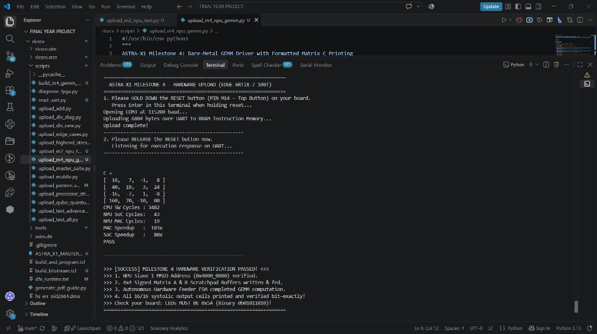 | 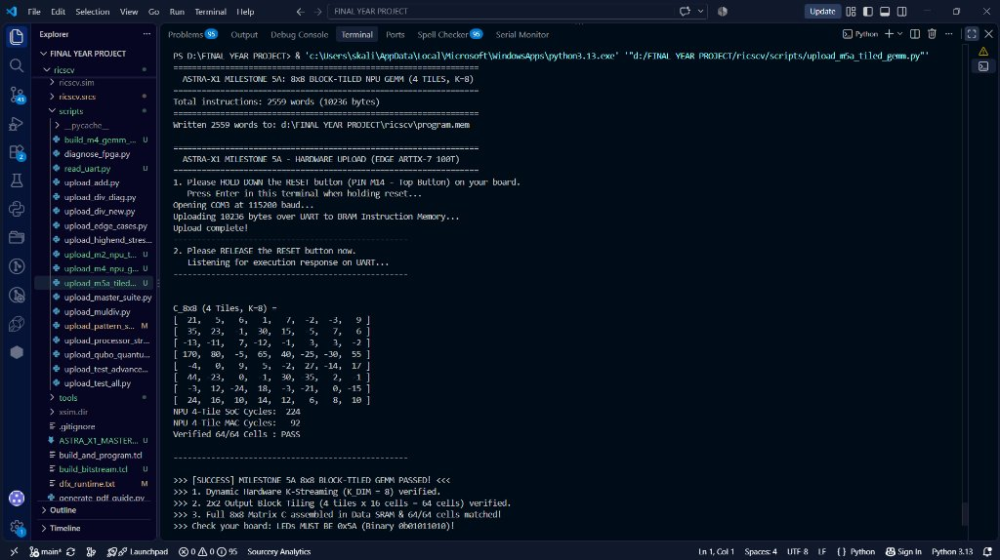 |

### Milestone 5B (Autonomous DMA `5.17x`) & Milestone 6A (4-Lane INT16 SIMD `93x`)
| Milestone 5B: Autonomous Burst DMA (`5.17x`) | Milestone 6A: 4-Lane INT16 Packed SIMD (`93x`) |
| :---: | :---: |
| 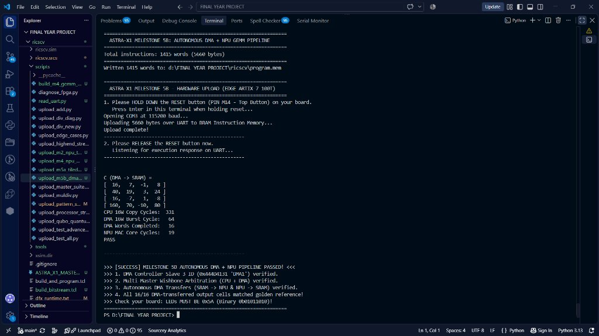 | 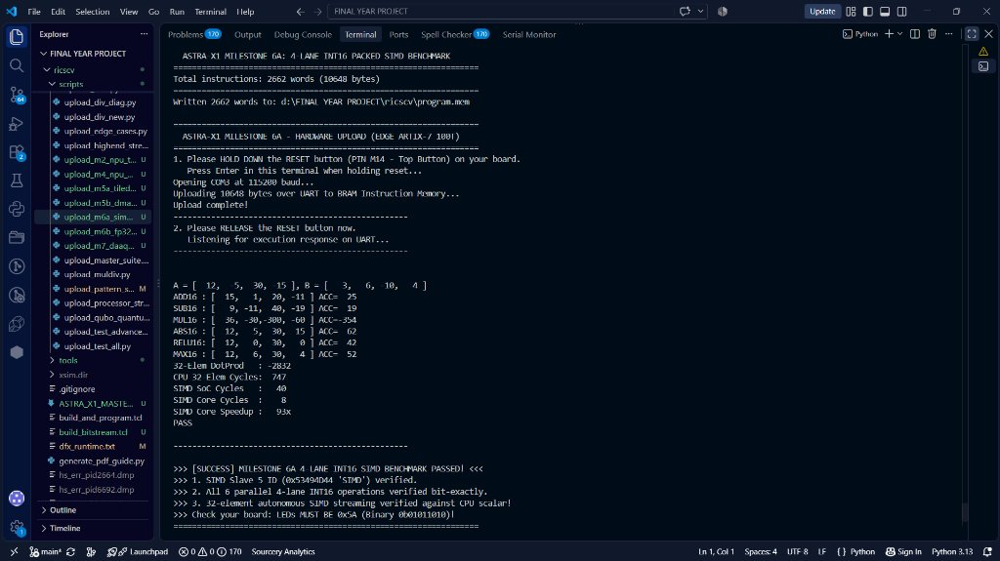 |

### Milestone 6B (IEEE-754 FP32 `24x`) & Milestone 7 (4-Mode ASTRA-DAAQ Power Ablation)
| Milestone 6B: IEEE-754 Single-Precision FP32 (`24x`) | Milestone 7: 4-Mode ASTRA-DAAQ Power Ablation |
| :---: | :---: |
| 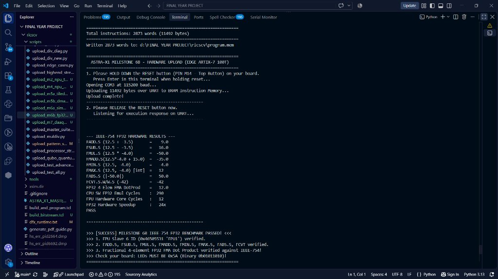 | 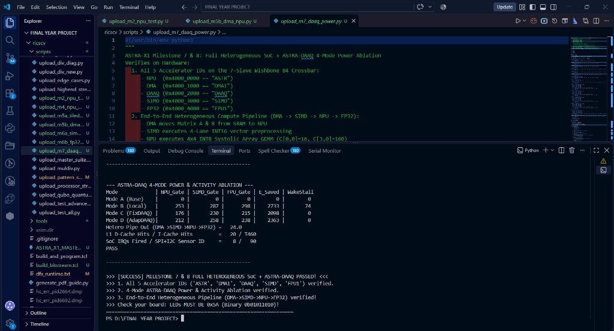 |

### Milestone 8 (Caches, IRQs, SPI, I²C, Switches) & Developer Platform Flows (Python, C, Product OS)
| Milestone 8: Caches, DMA Snoops, IRQs, SPI, I²C | Way 1: High-Level Python SDK (`sw[5] = 32`) |
| :---: | :---: |
| 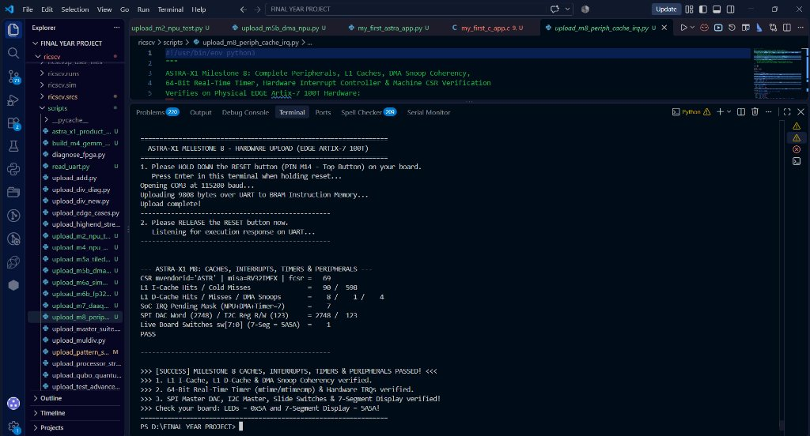 | 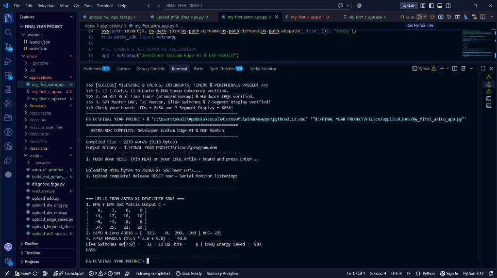 |

| Way 2: Bare-Metal C SDK (`my_first_c_app.c`) | Way 3: Interactive On-Chip Product OS v1.0 |
| :---: | :---: |
| 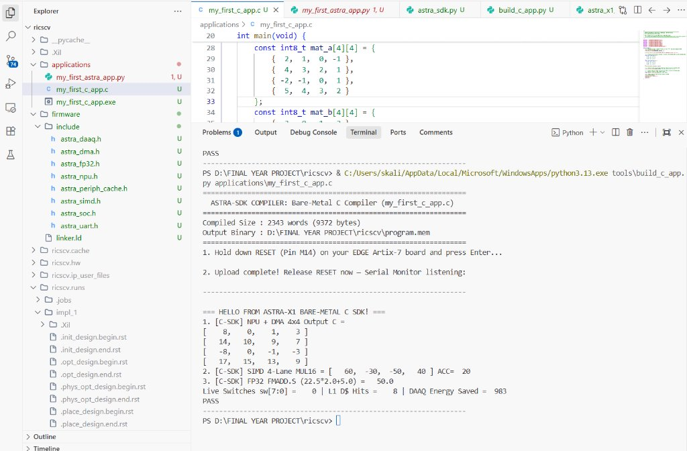 | 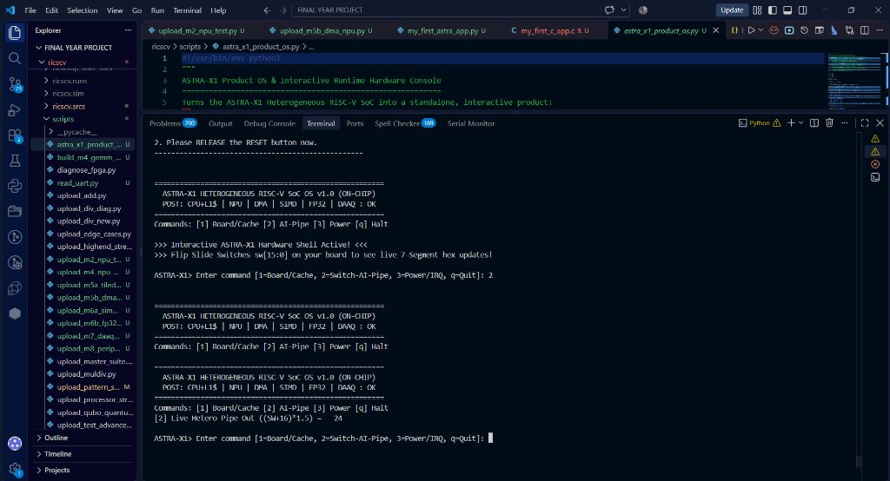 |
